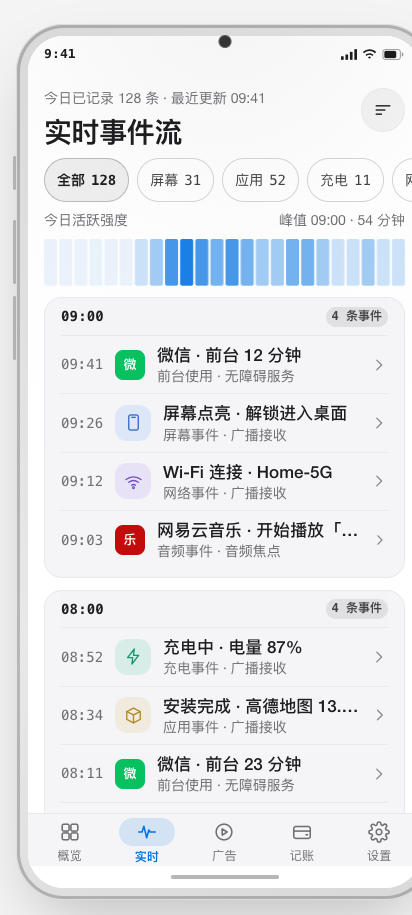
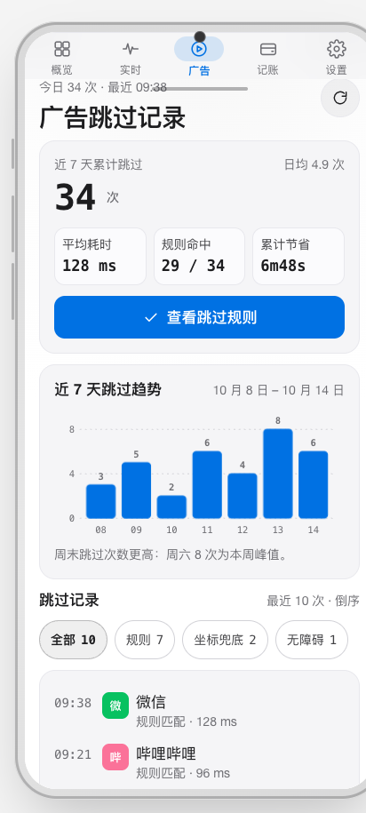
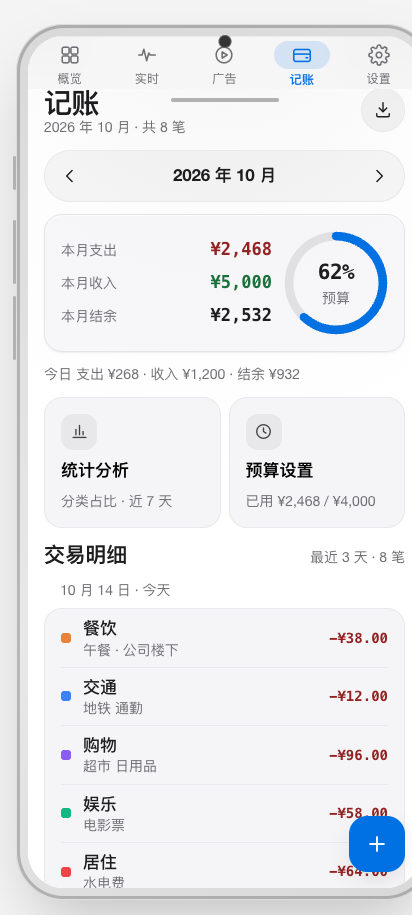
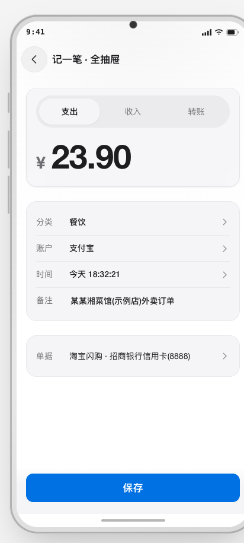
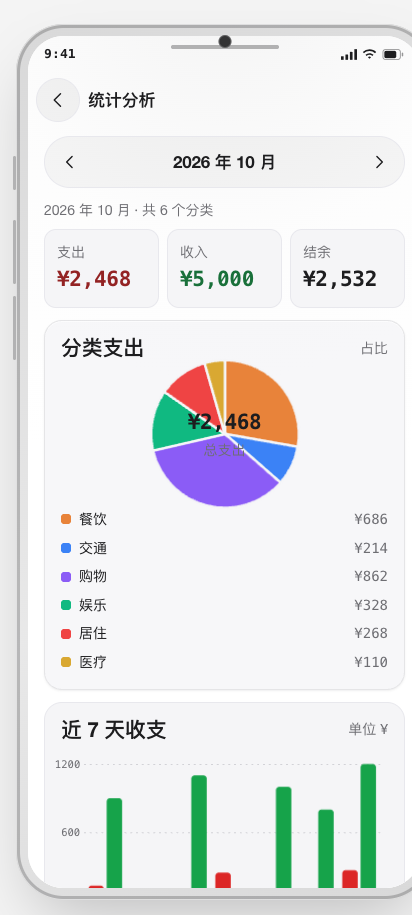
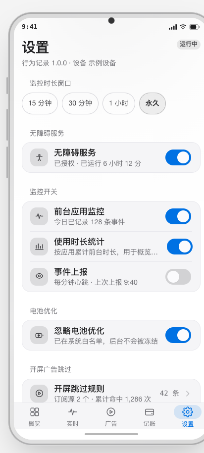
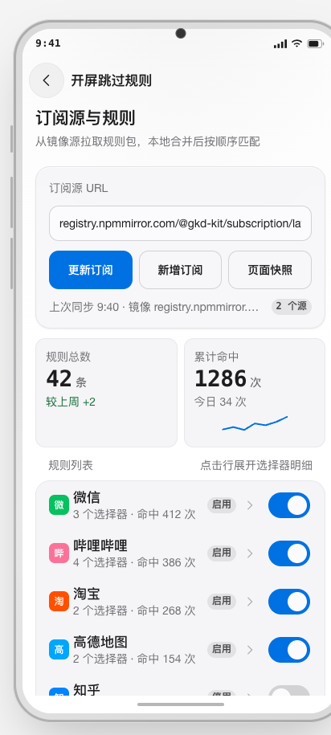
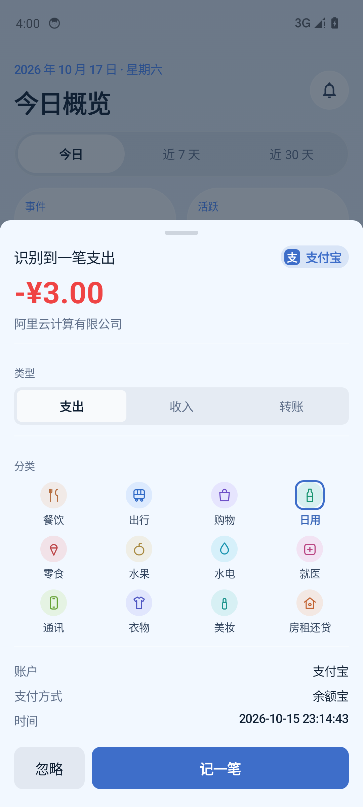

# android-monitor

[](https://github.com/baosfeng/android-monitor/actions/workflows/android-ci.yml)     

> 运行在 Android 上的个人效率与行为记录应用：记录应用使用、跳过开屏广告、局域网互传文件、记账与自动记账。

Kotlin + Jetpack Compose，遵循「零第三方业务依赖」——数据库、网络、序列化均用系统内置 API。技术栈：Kotlin 2.4、Compose、Navigation Compose、SQLiteOpenHelper、HttpURLConnection、org.json、Coroutines + Flow；最低 Android 10（API 29），target API 34。

## 界面预览

> 🎨 [在线预览可交互原型](https://baosfeng.github.io/android-monitor/)（GitHub Pages）

| 实时事件流 | 广告跳过 | 记账 | 记一笔 |
|:---:|:---:|:---:|:---:|
|  |  |  |  |
| **统计分析** | **设置** | **开屏跳过规则** | **自动记账浮窗** |
|  |  |  |  |

## 功能

| 模块 | 能力 |
|---|---|
| 记录系统 | 应用切换、使用时长、通知、来电等事件采集；本地合并与去重 |
| 开屏跳过 | 无障碍服务 + CSS 风格选择器规则引擎，内置规则 + 订阅更新 |
| 局域网互传 | UDP 组播发现、HTTP 流式传输、sha256 校验、PIN 配对、断点续传 |
| 记账 / 自动记账 | 分类 / 账户 / 交易 / 预算、统计图表、熊猫记账导入；识别微信 / 支付宝账单页弹浮窗确认后幂等落库 |
| 界面 | Compose 六标签（概览 / 实时 / 广告 / 记账 / 传送 / 设置），8 套主题 |

## 构建

需要 JDK 25 与 Android SDK Platform 37。

```bash
export JAVA_HOME=/opt/homebrew/opt/openjdk@25
# 可选：local.properties 指定后端地址（不入库） serverBaseUrl=http://<your-server>:<port>
./gradlew test assembleDebug      # 产物 app/build/outputs/apk/debug/app-debug.apk
./gradlew assembleRelease         # 需签名配置，见 docs/开发指南/发布指南.md
```

> 仓库不含签名文件：存在 `app/debug.keystore` 时沿用自定义签名，否则用 AGP 默认 debug keystore。

## 更新与发版

- 应用内「检查更新 → 下载 → 安装」，版本清单 `updates/version.json`；更新源按序回退：私有自建源 → jsDelivr → GitHub 镜像（ghfast.top / gh-proxy.com / ghproxy.net）→ GitHub 直连。
- 发版：`scripts/release.sh <x.y.z>` 递增版本并打 tag，CI 构建签名 APK、创建 Release、回写清单；公开 Release 的 APK 不含任何自建服务器地址，需要加速时本地构建私有版本注入地址。

细节见 [更新检测](docs/更新检测/概述.md) 与 [发布指南](docs/开发指南/发布指南.md)。

## 项目结构

```
app/      Android 应用：UI、无障碍服务、事件采集、网络、互传、记账、自动记账
domain/   与平台无关的领域模型与规则 DSL
docs/     中文文档：架构、协议、设计规范、踩坑记录
```

更多见 [文档索引](docs/索引.md)。

## 隐私与权限

数据默认只在本机处理，除非你主动配置后端地址。权限用途：无障碍服务（点开屏「跳过」、识别账单页）、使用情况访问（应用使用统计）、通知访问（元信息，正文可关）、`READ_PHONE_STATE`（来电事件）、前台服务（后台采集与传输）、网络（局域网互传、可选上报）。

- 数据存本地 SQLite，卸载即删；事件上报需自配 `serverBaseUrl`，默认占位地址不发数据。
- 检查更新只读公开版本清单并下载 APK，不采集设备信息。
- 不采集通讯录、短信正文、相册、位置与剪贴板内容。

## 贡献与许可

Issue / PR 流程见 [CONTRIBUTING.md](CONTRIBUTING.md) 与 [提交规范](docs/开发指南/提交规范.md)。许可证 [MIT](LICENSE)。
