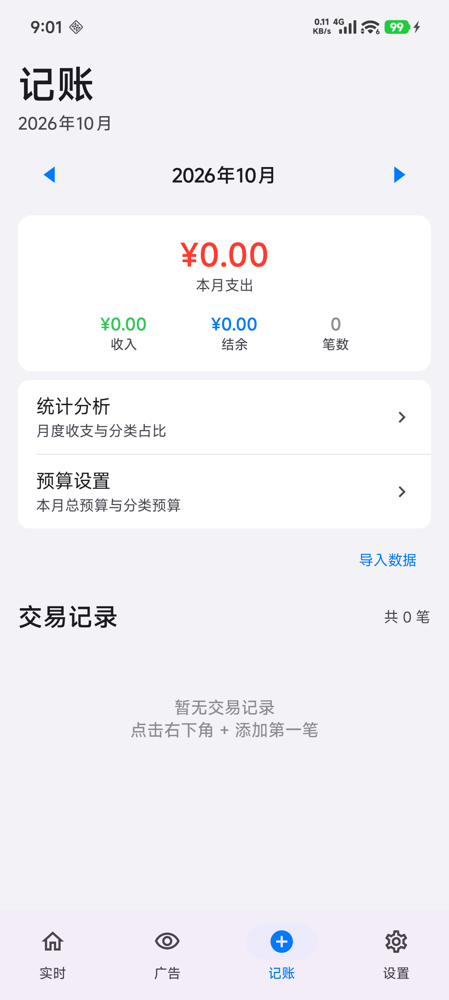
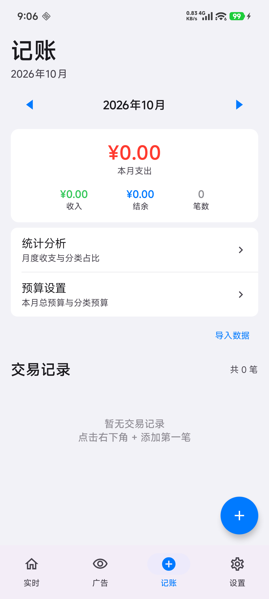

# 踩坑：记账首页 FAB 被底部导航栏遮住，用户无法新增交易

## 问题描述

记账 Tab 首页**看不到「+」悬浮按钮（FAB）**。右下角能看到的蓝色圆形加号是**底部导航栏「记账」Tab 自己的图标**
（`Icons.Filled.AddCircle` 选中态），两者极易混淆。

后果：用户点右下角「+」区域没有任何反应（点到的是导航栏或系统手势区），**无法新增任何交易 → 整个记账模块形同虚设**。
页面空状态还写着「点击右下角 + 添加第一笔」，属于误导。

## 影响范围

- 页面：`app/src/main/java/com/bsfeng/monitor/finance/ui/FinanceMainScreen.kt`（`FinanceMainScreen()` 里的 FAB 部分）
- 设备：小米 14 / HyperOS（edge-to-edge 全屏，Android 10+ 通用）
- 严重程度：⚠️ 功能完全不可用

## 根本原因

FAB 外面套了一个**高度约等于导航栏 inset 的 Box**：

```kotlin
Box(
    modifier = Modifier
        .align(Alignment.BottomEnd)
        .windowInsetsBottomHeight(WindowInsets.navigationBars)   // ← 容器高度只有 inset 那么高
) {
    FloatingActionButton(...)   // 56dp 高，远超容器高度
}
```

FAB（56dp ≈ 150px）从该容器顶部开始向下溢出，落到内容区之外；
而 Scaffold 的 `bottomBar` 绘制层级高于内容区，于是 FAB 被导航栏**完全盖住**。

像素级证据（修复前对记账首页截图做蓝色像素统计，右下角 y 2100~2500 / x 700~1200 区域）：

| 状态 | 该区域蓝色像素数 | uiautomator 是否可见 desc="添加" |
|------|----------------|-------------------------------|
| 修复前 | **0** | 否 |
| 修复后 | **22265** | 是（bounds [1032,2262][1104,2334]） |

### 修复前后对比

| 修复前（右下角只有导航栏的 Tab 图标，没有 FAB） | 修复后（FAB 正常浮在导航栏上方） |
|---|---|
|  |  |

## 解决方案

**删掉这层容器**，把 `align(BottomEnd)` 直接加在 FAB 自己的 Modifier 上：

```kotlin
FloatingActionButton(
    onClick = onAddClick,
    modifier = Modifier
        .align(Alignment.BottomEnd)
        .padding(MonitorSpacing.lg)
        .graphicsLayer { scaleX = fabScale; scaleY = fabScale }
        .pointerInput(Unit) { detectTapGestures(onPress = { ... }) },
) { Icon(Icons.Default.Add, contentDescription = "添加") }
```

Scaffold 的内容区已经排除了 `bottomBar` 高度，不需要再手动加导航栏 inset。

## 验证方法

截图 + 蓝色像素统计（比肉眼看截图可靠，能排除「Tab 图标被误认成 FAB」）：

```bash
A=~/android-platform-tools/adb
$A shell screencap -p /sdcard/s.png && $A pull /sdcard/s.png /tmp/s.png
python3 -c "from PIL import Image; im=Image.open('/tmp/s.png').convert('RGB'); px=im.load();
print(sum(1 for y in range(2100,2500) for x in range(700,1200)
  if px[x,y][2]>200 and px[x,y][0]<90 and 90<px[x,y][1]<180)))"

# 语义树复核（应出现 content-desc="添加"）
$A shell uiautomator dump /sdcard/ui.xml && $A pull /sdcard/ui.xml /tmp/ui.xml
grep -o 'content-desc="添加"[^>]*bounds="[^"]*"' /tmp/ui.xml
```

## 相关文件

- 页面与 FAB：`app/src/main/java/com/bsfeng/monitor/finance/ui/FinanceMainScreen.kt`
- 底部导航栏与 Tab 图标：`app/src/main/java/com/bsfeng/monitor/MainActivity.kt`（`tabs` 列表用 `AddCircle` 作记账图标）
- 相邻踩坑：[LocalDate 格式化 HH:mm 导致记账保存崩溃](LocalDate格式化HH-mm导致记账保存崩溃.md)
